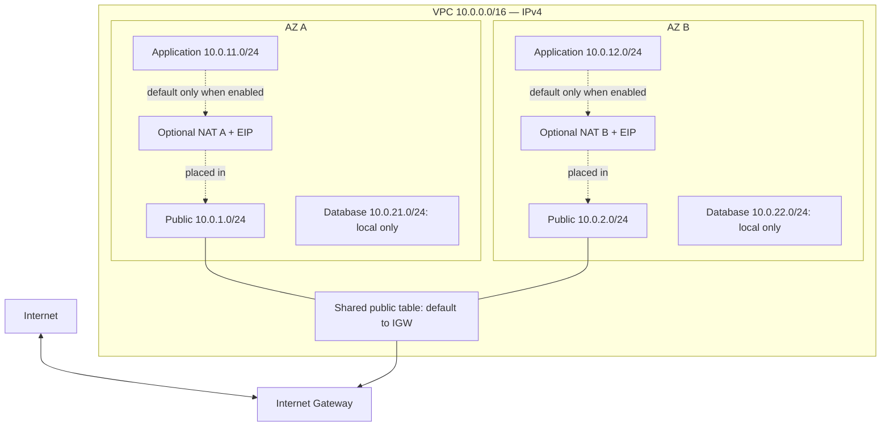

# Architecture and walkthrough

This page describes the Terraform implementation, not a future application.
The diagram below represents the implemented network resources and optional NAT.

## Current topology

All five managed route tables also have AWS's VPC-local route. Diagram lines
show routing relationships, not tested packet flow. No workload is deployed.

| Tier | Subnets (AZ A / AZ B) | Managed tables | Default route | Public IPv4 on launch |
|---|---|---:|---|---|
| Public | `10.0.1.0/24` / `10.0.2.0/24` | 1 shared | IGW | Enabled |
| Application | `10.0.11.0/24` / `10.0.12.0/24` | 2, one per AZ | None by default; same-AZ NAT if enabled | Disabled |
| Database | `10.0.21.0/24` / `10.0.22.0/24` | 2, one per AZ | None in both modes | Disabled |

Six explicit associations avoid accidentally relying on the AWS-created main
route table. That main table, default security group and default NACL are not
managed by this Terraform. "Database" names a subnet tier, not a database service.

## Decisions and limits

- **Two AZs:** practice repeatable placement and reduce a future workload's
  single-AZ dependency. No workload failover or availability is demonstrated.
- **NAT off by default:** a useful routing lab without standing NAT/EIP cost.
  App and database tiers have no general internet egress in this mode.
- **NAT per AZ when enabled:** app routes stay in the same AZ. A single shared
  NAT would reduce gateway count but introduce a cross-AZ dependency and
  possible transfer cost; this repository deliberately offers no third mode.
- **Database local-only:** no default or other non-local routes are configured.
  Internal reachability remains possible. Security groups would be required
  before adding workloads; routing is not a replacement for traffic filtering.
- **Simple root configuration:** maps and `for_each` express repetition without
  a module abstraction that has only one consumer. AZ map keys are stable;
  changing selected AZ names can still replace subnets and dependent resources.
- **Local state:** appropriate only for a single-operator lab with protected
  backup and serialized operations. Team collaboration would justify remote
  encrypted state, locking and tightly controlled access.

## Five-minute architecture walkthrough

**0:00–0:45 — Outcome.** “This portfolio project builds a cost-controlled AWS
network foundation using Terraform. I keep its scope to routing, repeatability
and verifiable configuration; there is no application or production claim.”

**0:45–1:45 — Trace the design.** Show the VPC, six /24s, five managed tables
and six associations. Explain the public IGW route, NAT-disabled application
routes and database local route. Identify the still-present internal path.

**1:45–2:30 — Tradeoffs.** Explain why two AZs are useful but insufficient for
high availability; why NAT is opt-in; and why per-AZ NAT was chosen over one
shared NAT when egress is needed. Mention future public IPv4 assignment risk.

**2:30–3:30 — Evidence.** Walk through fmt, init, validate, mocked tests and
Python tests as different checks. Run the good and bad fixtures. A database
NAT route violates the stated policy but does not prove public inbound access.
The checker reads snapshots and never repairs infrastructure.

**3:30–4:30 — Operations.** Explain state privacy, scoped read-only inspection,
reviewed plans, drift diagnosis, NAT/EIP cost and why completed teardown plus
resource inventory is stronger evidence than a destroy plan alone.

**4:30–5:00 — Boundaries and ownership.** Identify unverified live behavior,
deferred workload controls and AI assistance. Explain one personal requirement
change only after actually completing it. Do not claim mastery from CI results.

## Technical references

- [AWS subnet route tables](https://docs.aws.amazon.com/vpc/latest/userguide/subnet-route-tables.html)
- [AWS security groups](https://docs.aws.amazon.com/vpc/latest/userguide/vpc-security-groups.html)
- [Default network ACL](https://docs.aws.amazon.com/vpc/latest/userguide/default-network-acl.html)
- [Terraform provider mocking](https://developer.hashicorp.com/terraform/language/tests/mocking)
